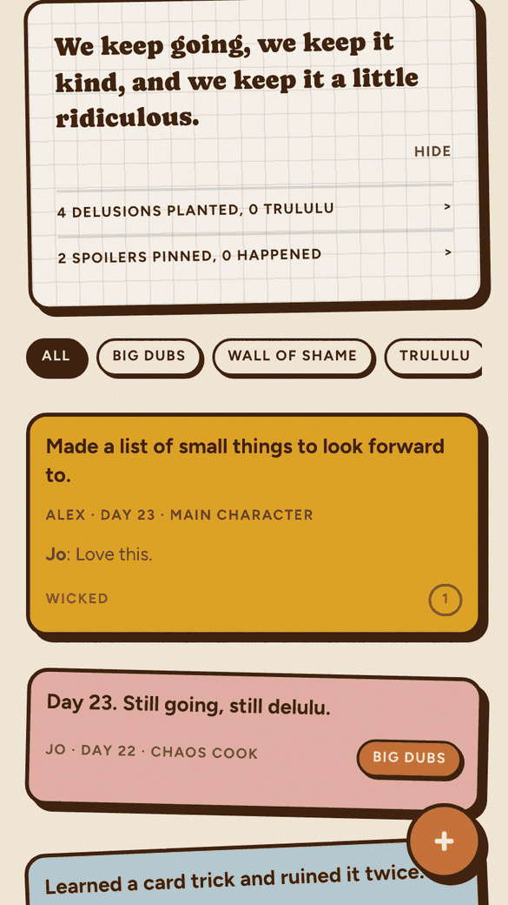
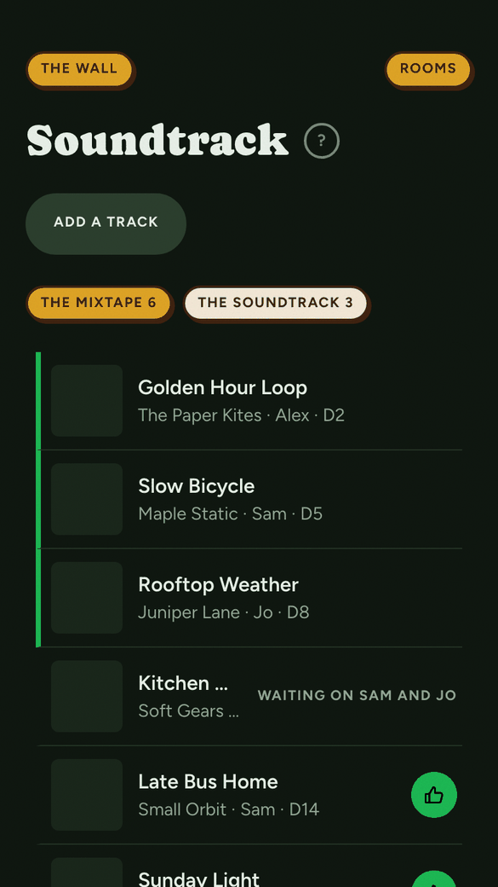
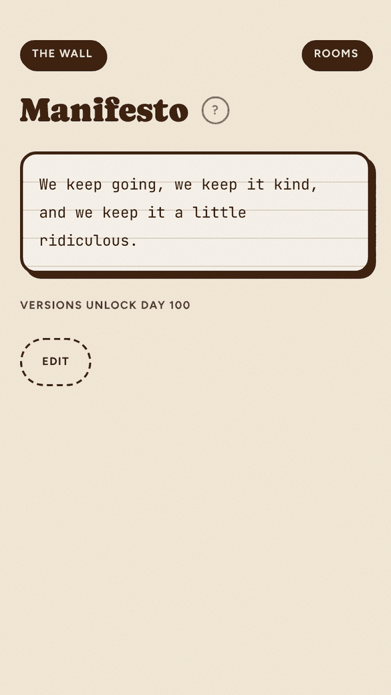
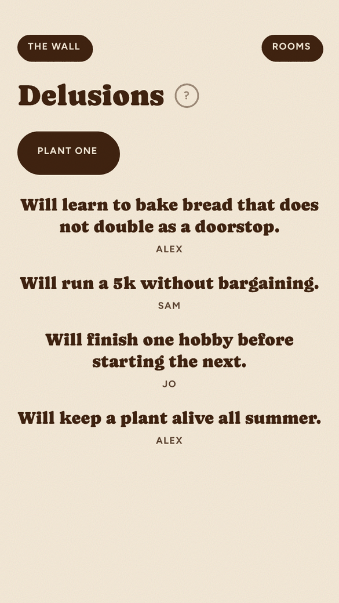
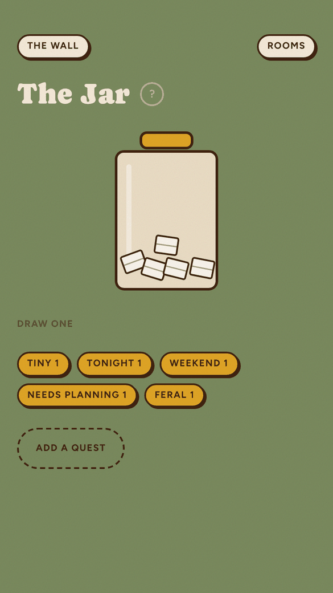
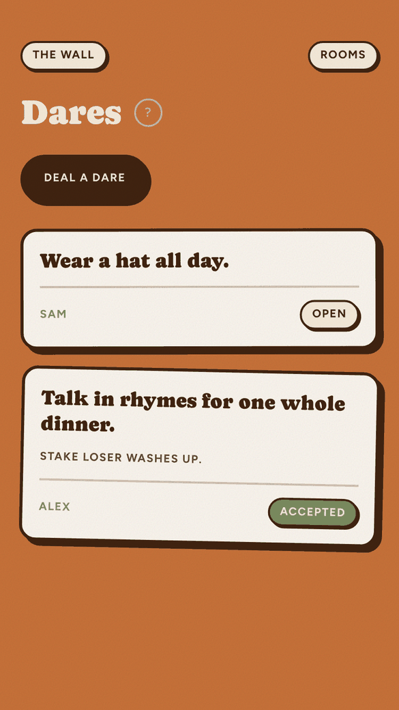
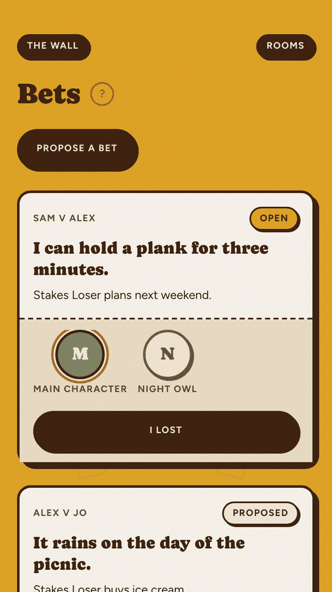
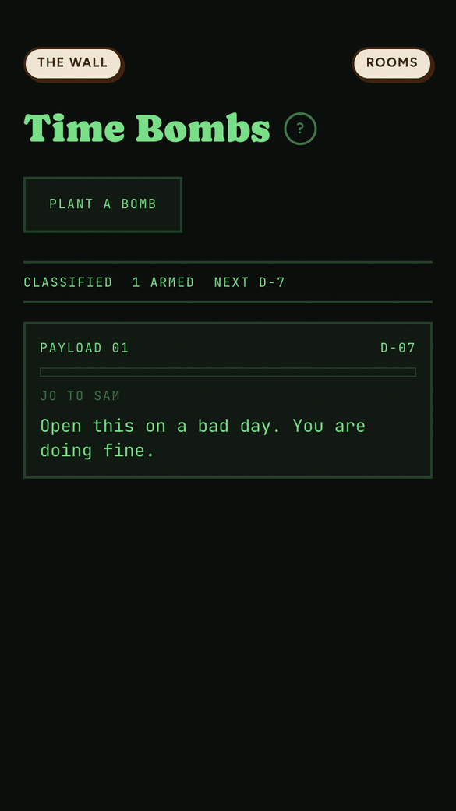
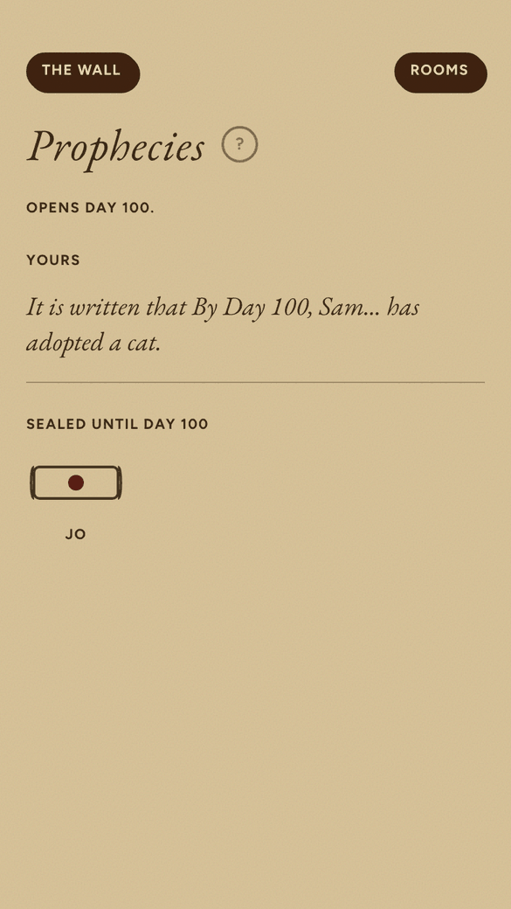

# 100 Days of Delulu

A shared scrapbook for a 100-day challenge. You and a few people you like
post to one wall every day, and a ring of small games around it keeps the
hundred days from going quiet.

<p>
  
  
  
</p>

## What it is

It is built for a couple or a small group (2 to 8 people) who want to do
something together for 100 days and keep a record of it. There are no
accounts. Everyone enters one shared passcode, picks their name, and starts
posting. It is a PWA designed for phones, so you can add it to your home
screen. You host it yourself, so the data stays in your own database.

## Features

- **Wall**: photos, notes, voice memos, videos and link cards, newest first.
- **Manifesto**: the rules the group is living by, edited once a day.
- **Delusions**: lives you behave as if you already have, stamped when one happens.
- **Spoilers**: a picture of the life you want, pinned before it happens.
- **The Jar**: quests drawn at random, from tiny to feral.
- **Truth**: one question a day, answers revealed together.
- **Dares**: things you make each other do.
- **Bets**: a claim and what it costs to be wrong.
- **Time Bombs**: a note that opens later.
- **Prophecies**: a call on what happens by day 100, sealed and judged at the end.
- **Checkpoints**: milestones at days 10, 25, 50, 75 and 100.
- **Soundtrack**: a shared Mixtape with a vinyl player.

## A look around

Screenshots are from the seeded demo data at phone width.

<table>
  <tr>
    <td align="center"><br><sub>Manifesto</sub></td>
    <td align="center"><br><sub>Delusions</sub></td>
    <td align="center"><br><sub>The Jar</sub></td>
    <td align="center"><br><sub>Dares</sub></td>
  </tr>
  <tr>
    <td align="center"><br><sub>Bets</sub></td>
    <td align="center"><br><sub>Time Bombs</sub></td>
    <td align="center"><br><sub>Prophecies</sub></td>
    <td align="center"><br><sub>Checkpoints</sub></td>
  </tr>
</table>

## Quickstart

You need Node 22, pnpm 10 (`corepack enable`) and a Postgres database. A free
[Neon](https://neon.tech) project works.

1. Clone it: `git clone https://github.com/brittanyperera-glitch/delulu-template.git && cd delulu-template`
2. Install: `pnpm install`
3. Create `.env.local`: `pnpm run setup`. It copies `.env.example` and writes a
   fresh `SESSION_SECRET`. Put your `DATABASE_URL` and a long `GROUP_CODE` in
   the file, then run `pnpm run setup` again to apply the migrations.
4. Start it: `pnpm dev`
5. Open <http://localhost:3000/setup>, enter the passcode, then add 2 to 8
   members (a name and a colour each), and pick day one and the timezone.

Use `pnpm run setup`, not `pnpm setup`: the latter is a built-in pnpm command.
`pnpm dev` does not migrate, so run setup once, and again after pulling a
change that adds a migration. Uploads need `BLOB_READ_WRITE_TOKEN` (see below).

## Configuration

Set these in `.env.local` for development and in your host's environment
variables for production.

| Variable | Required | What it does |
|---|---|---|
| `GROUP_CODE` | yes | The one passcode everyone types at the gate. It is the only thing between the site and anyone who finds the URL. |
| `SESSION_SECRET` | yes | Signs the session cookie. At least 16 characters. `openssl rand -base64 32` makes one. |
| `DATABASE_URL` | yes | Postgres connection string. Needed at build time as well, because `pnpm build` runs the migrations. |
| `BLOB_READ_WRITE_TOKEN` | for uploads | Vercel Blob token. Without it the wall works for text but photo, voice and video uploads fail. |
| `DEMO_MODE` | no | Set to `1` to disable uploads and show a demo banner. |

## Make it yours

- **At setup:** who is in (2 to 8, each with a name and colour), day one and the timezone.
- **`src/config/site.ts`:** the name, tagline, number of days, checkpoint days, the
  day prophecies seal, and the default timezone.
- **In code:** the copy in `src/lib/content/strings.ts`, the daily questions and
  composer prompts in `docs/content/` (run `pnpm content` after editing), and the
  colours in `src/app/globals.css`.

Only a 100-day season has been tested. The daily question bank has 100
entries, so a longer season needs more questions.

## Deploy

[](https://vercel.com/new/clone?repository-url=https%3A%2F%2Fgithub.com%2Fbrittanyperera-glitch%2Fdelulu-template&project-name=delulu&repository-name=delulu&env=GROUP_CODE,SESSION_SECRET,DATABASE_URL&envDescription=Gate%20passcode%2C%20a%20session%20secret%20of%2016%2B%20characters%2C%20and%20a%20Postgres%20URL&envLink=https%3A%2F%2Fgithub.com%2Fbrittanyperera-glitch%2Fdelulu-template%2Fblob%2Fmain%2Fdocs%2Fself-hosting.md&stores=%5B%7B%22type%22%3A%22blob%22%2C%22access%22%3A%22public%22%7D%5D)

The button clones the repo into your GitHub account, asks for the three
values above and creates a Blob store. You still need a Postgres database to
paste in as `DATABASE_URL`. Step-by-step instructions, a custom domain and
demo mode are in [docs/self-hosting.md](docs/self-hosting.md).

## Commands

```
pnpm dev          run locally
pnpm typecheck    types
pnpm lint         Biome
pnpm test         unit, component and database tests
pnpm e2e          phone-width browser test
pnpm build        migrate, then production build
```

## Licence

MIT. See [LICENSE](LICENSE). Contributions are covered in [CONTRIBUTING.md](CONTRIBUTING.md).
